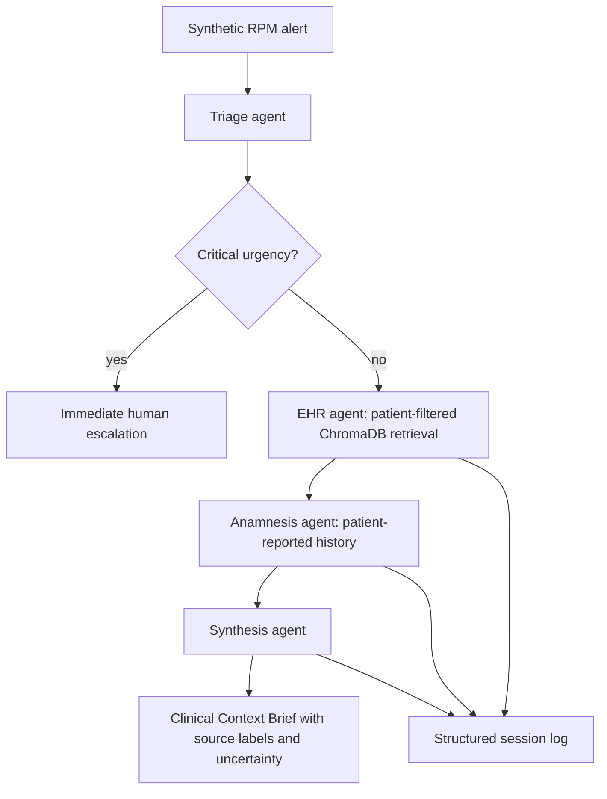

# ClinicalBridge

**Multi-agent RAG that turns a monitoring alert into a source-attributed context brief, with explicit escalation and failure handling.**

Four specialist agents plus an orchestrator combine an alert, retrieved EHR history and patient-reported history. The engineering focus is keeping sources distinct, carrying uncertainty forward, and making safety-critical routing deterministic.

This is an academic prototype using synthetic patient records, built for COP-3442 at Bahcesehir University. It is not a clinical decision tool.

## Inspect the proof

| Evidence | Where to look |
|---|---|
| **5/5 gold scenarios; 15/15 designed failure-mode checks** | [Evaluation report](portfolio/EVALUATION_REPORT.md) and [saved outputs](eval/results/); qualitative checks include manual review |
| **8 targeted stress cases** | [`eval/stress_tests.py`](eval/stress_tests.py) |
| A real schema defect, failed prompt-only fix, then a verified code fix | [Prompt engineering portfolio, section 3.6](portfolio/PROMPT_ENGINEERING_PORTFOLIO.md) |
| Critical-alert bypass, retries and low-confidence fallbacks | [`orchestrator/orchestrator.py`](orchestrator/orchestrator.py) |
| **8 offline OpenTelemetry instrumentation checks** | [`eval/test_observability.py`](eval/test_observability.py); opt-in orchestration and retrieval tracing |

## Architecture



**Stack:** Python, LangChain, Gemini and ChromaDB. EHR and anamnesis retrieval are dispatched sequentially in the inspected implementation to accommodate provider rate limits.

## The most useful failure story

An off-topic EHR query exposed a missing-key defect: the model omitted `relevant_labs` instead of returning an empty list. A more explicit prompt and a matching example did not fix the repeated failure. Inspection confirmed retrieval had supplied the relevant context; the defect was in generated output.

The code-level fix normalizes the expected list fields after JSON parsing, before schema validation. The same stress case then returned a complete, valid structure. This is the tradeoff the project demonstrates: use the model for extraction and synthesis, and code for stable output contracts.

| Boundary | Implementation choice |
|---|---|
| Critical escalation | Orchestrator branch bypasses downstream retrieval/synthesis |
| Missing output fields | Deterministic normalization followed by schema validation |
| Retrieval failure | Bounded retry, then explicit empty/low-confidence input |
| Source disagreement | Preserve EHR and anamnesis attribution and uncertainty |
| Terminal generation failure | Return a failed workflow with a session log |

## Run and inspect

Use [SETUP.md](SETUP.md) for dependencies, vector-store preparation and provider configuration. Agent execution requires `GOOGLE_API_KEY`; `GEMINI_MODEL` configures the model. Keep credentials local.

```bash
# Inspect saved outputs without making model calls.
python3 -m eval.compare_results

# With the documented environment and vector stores configured:
python3 -m eval.run_all_scenarios
python3 -m orchestrator.test_critical_bypass
python3 -m eval.run_stress_tests
```

`compare_results` displays gold/actual comparisons and the designed review checks. It does not automatically grade every semantic check. The 5/5 and 15/15 results are the documented project evaluation, not a clinical accuracy claim; retrieval precision/recall was not numerically measured.

## Source tour

- [`agents/triage_agent.py`](agents/triage_agent.py): structured urgency classification and retrieval queries.
- [`agents/ehr_agent.py`](agents/ehr_agent.py): retrieval, output normalization and schema checks.
- [`agents/anamnesis_agent.py`](agents/anamnesis_agent.py): patient-reported evidence.
- [`agents/synthesis_agent.py`](agents/synthesis_agent.py): source-aware context brief.
- [`eval/run_stress_tests.py`](eval/run_stress_tests.py): targeted edge-case execution.

Course-project contributors listed in the evaluation report: Mhd Wael Abo Kalam, Marvan Ahmad, Talal Haneyeh and Karim S M Seyam.

More shipped product work: [TQEN](https://tqentech.com), [Crave It](https://craveitsyria.com), and [sanitized production architecture case studies](https://github.com/waelabokalam/production-systems-architecture).

## Optional local OpenTelemetry evaluation

The orchestrator, its agent-call boundary and both retrieval functions have opt-in spans. Tracing is disabled by default, so normal execution does not import the OpenTelemetry SDK or create an exporter. The optional exporter stays in memory: no collector, endpoint, credential or global provider is configured.

Run the instrumentation checks without a model key, vector-store preparation or patient dataset:

```bash
python3 -m venv .venv-observability
.venv-observability/bin/python -m pip install -r requirements-observability.txt
.venv-observability/bin/python -m pytest -q -p no:cacheprovider eval/test_observability.py
```

The **8 passing offline checks** exercise the real orchestrator with agent responses stubbed, and test the real EHR/anamnesis retrieval functions separately with model/vector adapters stubbed. They check span parentage, patient-scoped retrieval filters, disabled behavior, redaction, failure status and exporter failure. They do not exercise the full live multi-agent/provider chain or replace the historical gold-scenario evaluation.

This small example also runs without the application providers:

```python
from orchestrator.observability import LocalTracing, trace_operation


@trace_operation("orchestrator")
def synthetic_evaluation():
    return {"status": "completed"}


telemetry = LocalTracing(enabled=True)
try:
    with telemetry.activate():
        result = synthetic_evaluation()
    for span in telemetry.exporter.get_finished_spans():
        print(span.name, dict(span.attributes))
finally:
    telemetry.shutdown()
```

For an actual configured workflow, use the same `with telemetry.activate():` block around `process_alert(...)`; the provider and vector-store setup in [SETUP.md](SETUP.md) still applies.

Span names are closed constants; only bounded outcomes and document counts enter spans. Prompts, patient IDs, retrieved text, result bodies, exception messages and stack traces are not exported. Existing application session logs are separate and unchanged, so they still need their own data-handling policy. This is locally verified academic instrumentation, not a clinical deployment or a measured latency improvement.

See the [sanitized tracing walkthrough and captured test proof](https://github.com/waelabokalam/production-systems-architecture/blob/main/case-studies/clinicalbridge-tracing.md) for the architecture and verification boundaries. The exporter follows the [official OpenTelemetry Python instrumentation API](https://opentelemetry.io/docs/languages/python/instrumentation/).
